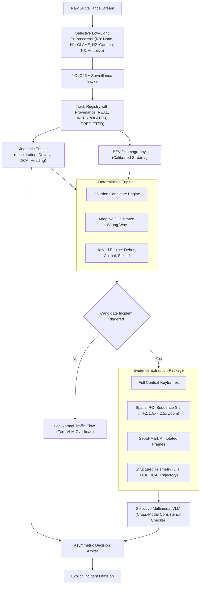

# Spatiotemporal Hardening and Multimodal VLM Arbitration Plan (Refined)

## Executive Summary
This document establishes the frozen architecture roadmap and experimental protocol for **Perception and Tracking Hardening (J+)** and **Iteration H: Selective Multimodal VLM Arbitration**.

Following architectural review, we strictly enforce:
1. **Preserve the Hybrid Core**: Computer Vision and Kinematics = Physical Measurement; Rules Engine = Fast Hypothesis Generation; Multimodal VLM = Selective Semantic Arbiter; Asymmetric Fusion = Explicit Authority Matrix. The VLM is **never** a continuously running detector.
2. **Sequential Discipline**: Perception/tracking hardening (J+) and low-light ablations (N0-N3) must be benchmarked and frozen **before** testing the VLM ladder (H0-H4).
3. **Three-Way Track Provenance**: Track points are explicitly tagged `REAL`, `INTERPOLATED`, or `PREDICTED`. Purely predicted or interpolated frames are forbidden from fabricating collision candidates.
4. **Precise Kinematics**: Explicitly distinguish deceleration $|a| > 1.0g$ ($9.81\text{ m/s}^2$) from velocity change $|\Delta v| > X\text{ m/s}$. Metric thresholds (e.g. $DCA < 0.5m$) apply exclusively when BEV/Homography is calibrated.
5. **Universal Evidence Extractor**: Shared across Collisions, Wrong-Way, Debris, Stalled Vehicles, and Animals.

---

## 1. System Architecture



---

## 2. Track Provenance and Safety Invariants

Every point in a vehicle track trajectory carries an explicit provenance tag:
- **`REAL`**: Bounding box and ground point directly measured from YOLO detector output in that frame.
- **`INTERPOLATED`**: Bounding box linearly or spline interpolated across a short occlusion gap ($\le 6$ frames / $0.2\text{s}$) bounded by real observations on both sides.
- **`PREDICTED`**: Forward-projected / coasted via constant-velocity or Kalman state without future observation closure.

### Safety Invariants:
1. **Real Observation Proximity**: Any candidate collision or physical incident trigger requires at least one **`REAL`** track point within $\le 3$ frames of the point of maximum conflict / contact.
2. **Anti-Hallucination Guard**: Incidents cannot trigger across pure `INTERPOLATED` or `PREDICTED` spans without contemporaneous physical sensor grounding.

---

## 3. Low-Light Preprocessing Ablation Ladder (Phase 1 / J+)

We evaluate low-light enhancement as a controlled ablation rather than a guaranteed benefit:

| Code | Configuration | Strategy | Hypothesis / Risk |
| :--- | :--- | :--- | :--- |
| **N0** | Raw Baseline | No image preprocessing | Benchmark baseline |
| **N1** | CLAHE | Contrast-Limited Adaptive Histogram Equalization ($clip=2.0$, $8\times 8$) | Recovers dark silhouettes; risk: headlight glare blooms |
| **N2** | Gamma Correction | Power-law luminance compression ($\gamma = 0.65$) | Preserves gradient smoothness; risk: washes out lane lines |
| **N3** | Adaptive Selection | Trigger CLAHE/Gamma only when mean $Y < 45$ | Zero daytime regression, active in night / tunnels |

**Metrics evaluated**: Vehicle recall, Track fragmentation, ID switches, Collision recall, False Positive episodes, and Processing FPS.

---

## 4. Universal Evidence Extractor

The `EvidenceExtractor` serves all incident types (Collision, Wrong-Way, Debris, Animal, Stalled Vehicle):
- **Candidate Metadata**: `incident_type`, `track_ids`, `trigger_frame`, `roi_bbox`, `confidence`.
- **Temporal Window**: 5 keyframes: $[t_{-2}, t_{-1}, t_0, t_{+1}, t_{+2}]$ covering pre-event, impact/event point, and post-event rebound/stalling.
- **Visual Artifacts**:
  1. Full-frame context image.
  2. Crop-and-zoom ROI images ($1.8\times - 2.5\times$ target bounding envelope resized to $336\times 336$ or $448\times 448$).
  3. Set-of-Mark (SoM) highlighted versions with track IDs and bounding indicators.
- **Telemetry Package**:
  ```json
  {
    "incident_type": "collision",
    "calibrated": true,
    "time_to_closest_approach_s": 0.0,
    "distance_at_closest_approach_m": 0.18,
    "track_A": {
      "id": 3, "class": "sedan",
      "v_pre_mps": 22.4, "v_post_mps": 4.1,
      "max_deceleration_mps2": 14.8, "deceleration_g": 1.51
    },
    "track_B": {
      "id": 7, "class": "van",
      "v_pre_mps": 0.0, "lateral_displacement_m": 2.8
    }
  }
  ```

---

## 5. VLM Evidence Ladder (H0 to H4 Ablation)

The VLM is queried as a **cross-modal consistency checker**:
*"Does the visual evidence support the physical event described by the measurements?"*

| Ladder | Name | Inputs | Target Verification |
| :--- | :--- | :--- | :--- |
| **H0** | Global Raw Frames | 3 Full Frames | Baseline resolution limit |
| **H1** | Spatial ROI Crop | 3 Cropped ROI Frames | Token compression resolution test |
| **H2** | Set-of-Mark (SoM) | 3 ROI Frames + ID tags / boxes | Visual attention and target attribution |
| **H3** | Dense Temporal Sequence | 5 ROI Frames ($t_{-2} .. t_{+2}$) | Dynamic physical motion and rebound |
| **H4** | Full Multimodal Fusion | 5 ROI Frames + SoM + Telemetry JSON | Complete cross-modal consistency |

---

## 6. Asymmetric Fusion Authority Matrix

Explicit, unambiguous operational states:

| CV Kinematic Evidence | VLM Verdict | Final Incident Decision | Operational Action |
| :--- | :--- | :--- | :--- |
| **HIGH** ($|a| > 1.0g$, calibrated $DCA < 0.5m$, or high-speed head-on) | **CONFIRM** | `INCIDENT_CONFIRMED` | Dispatch immediate alert |
| **HIGH** | **UNCERTAIN** | `INCIDENT_CONFIRMED` | Accept physical CV evidence (dark/glare/rain) |
| **HIGH** | **REJECT** | `INCIDENT_CONFIRMED_PENDING_REVIEW` | CV physical evidence cannot be erased by visual difficulty |
| **MEDIUM / LOW** (Marginal IoU, visual passing, glare) | **CONFIRM** | `INCIDENT_CONFIRMED` | Multimodal consensus elevates marginal event |
| **MEDIUM / LOW** | **REJECT** | `SUPPRESSED_FALSE_ALARM` | VLM successfully eliminates false alarms |
| **MEDIUM / LOW** | **UNCERTAIN** | `FLAGGED_FOR_HUMAN_REVIEW` | Ambiguous visual & physical signals sent to human operator |
| **NONE** (No candidate trigger) | N/A | `NORMAL_FLOW` | VLM never called (0 compute cost) |

---

## 7. 10-Step Controlled Execution Schedule

- [ ] **Step 1: Track Provenance & Safety Invariant Implementation** (`REAL`, `INTERPOLATED`, `PREDICTED` tagging + 3-frame REAL invariant).
- [ ] **Step 2: Low-Light Preprocessing Ablation** (Benchmark N0, N1, N2, N3 across day/night video suite).
- [ ] **Step 3: Freeze Perception Configuration** (Select optimal tracker + illumination pipeline).
- [ ] **Step 4: Shared Universal EvidenceExtractor** (Implement unified multi-incident evidence generator).
- [ ] **Step 5: H0 Baseline Execution** (Run baseline full-frame prompts on test cases).
- [ ] **Step 6: H1 ROI Crop Ablation** (Measure delta on distant/night targets).
- [ ] **Step 7: H2 Set-of-Mark Ablation** (Measure delta on multi-vehicle cluttered intersections).
- [ ] **Step 8: H3 Dense Temporal Sequence Ablation** (Measure delta on kinematic impact dynamics).
- [ ] **Step 9: H4 Telemetry Fusion Ablation** (Measure cross-modal consistency delta).
- [ ] **Step 10: Asymmetric Arbitration Integration & Regression Benchmark** (Run full suite, verify 0 FP retention, profile invocation rate and latency).
